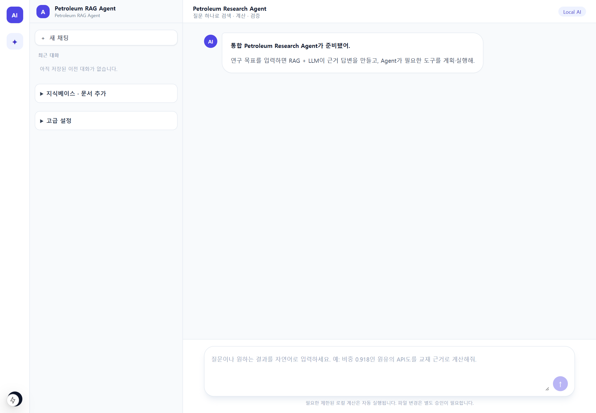
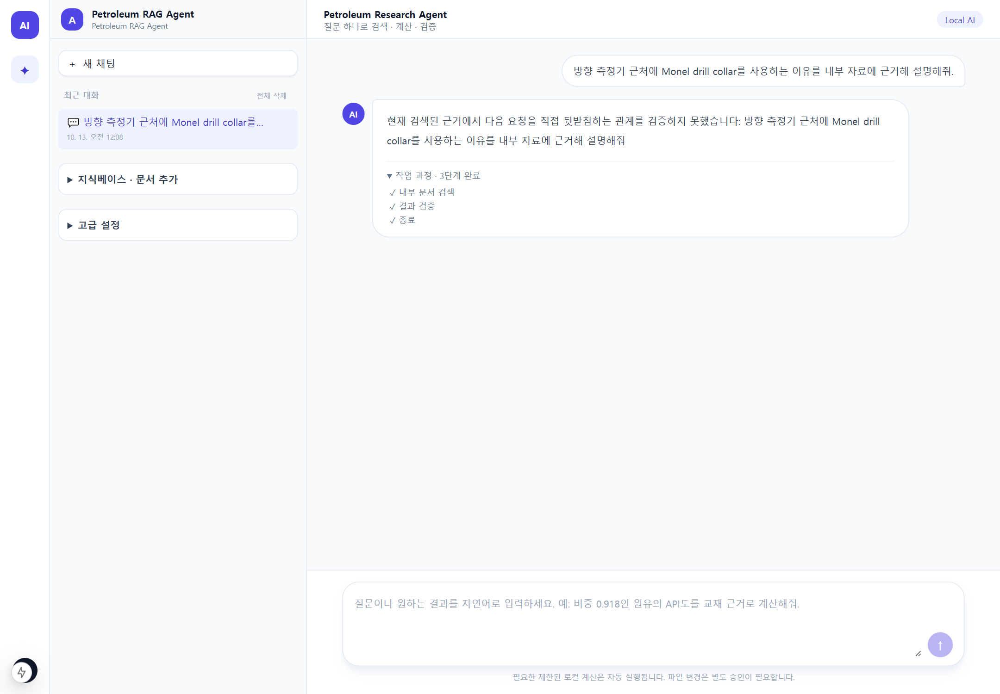
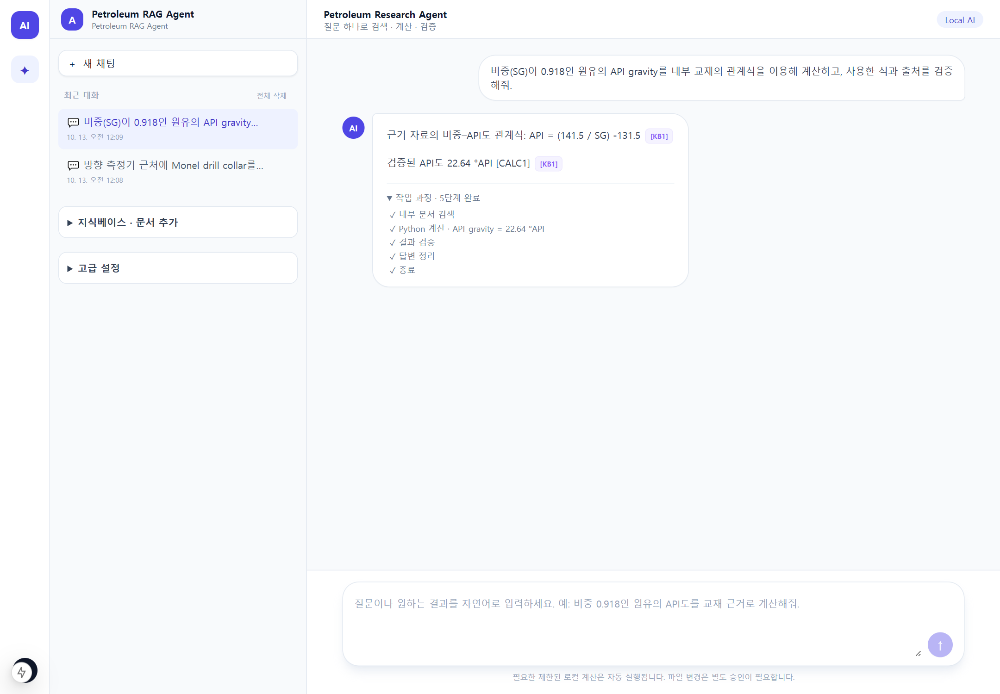
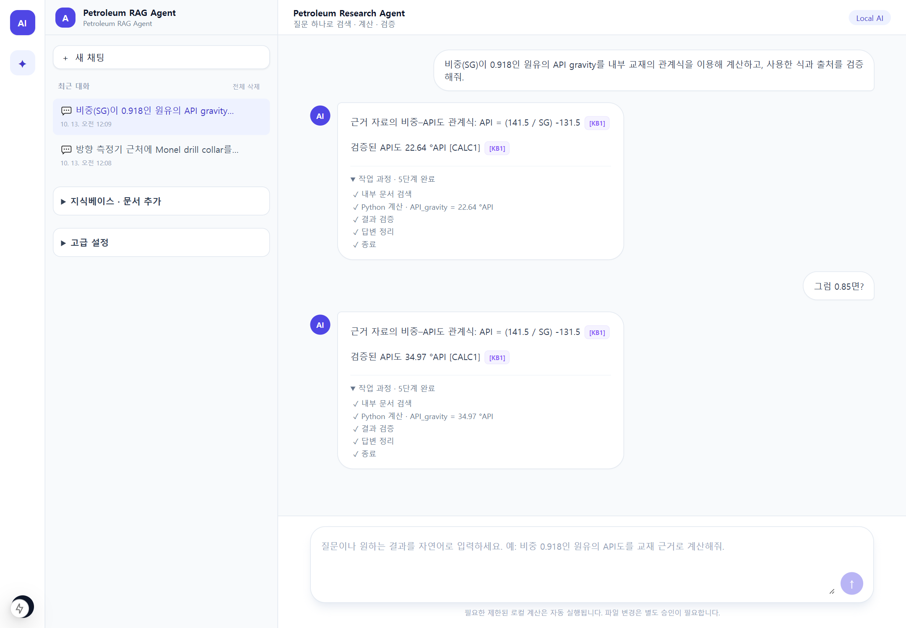
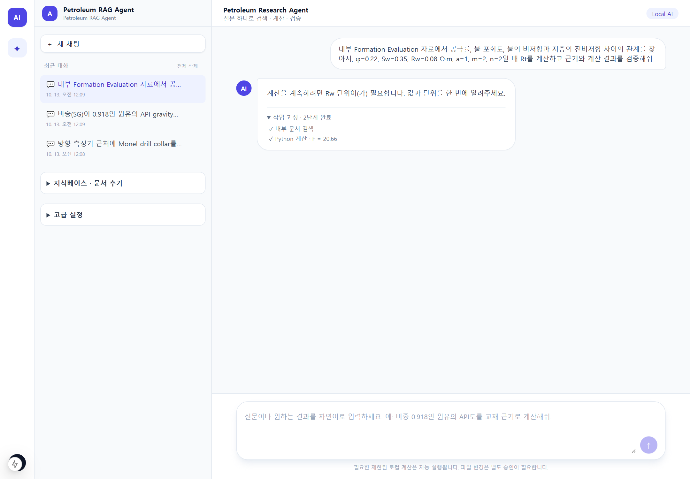
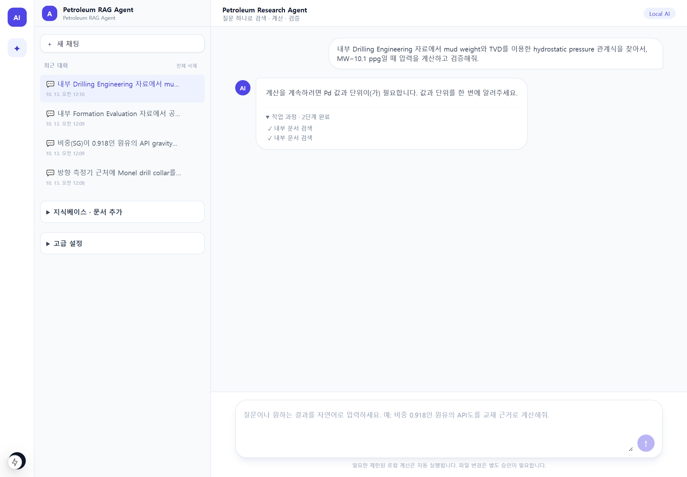
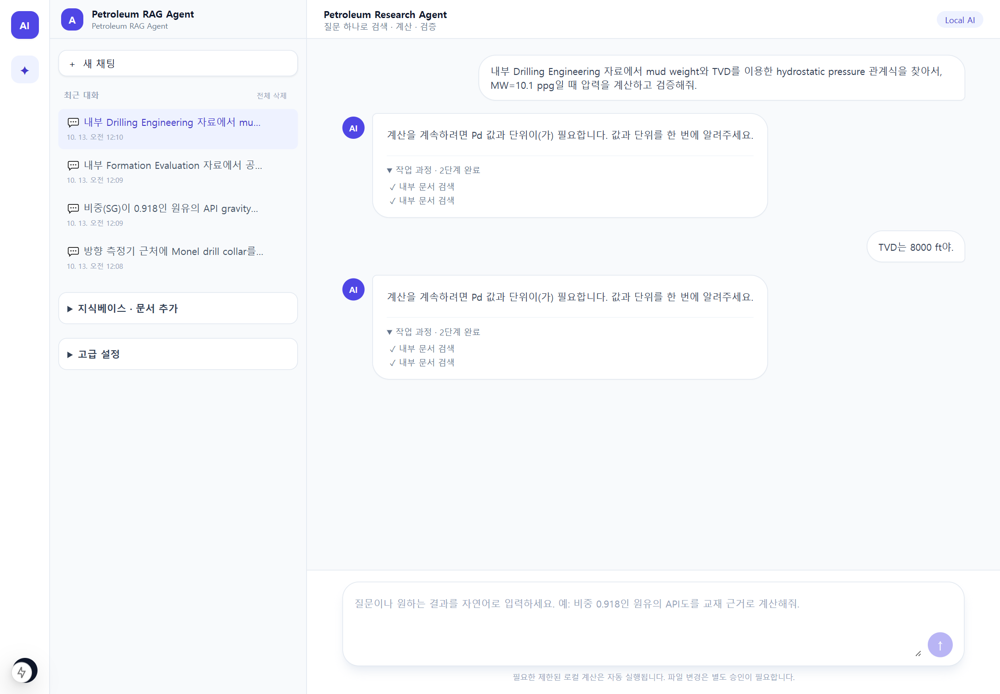
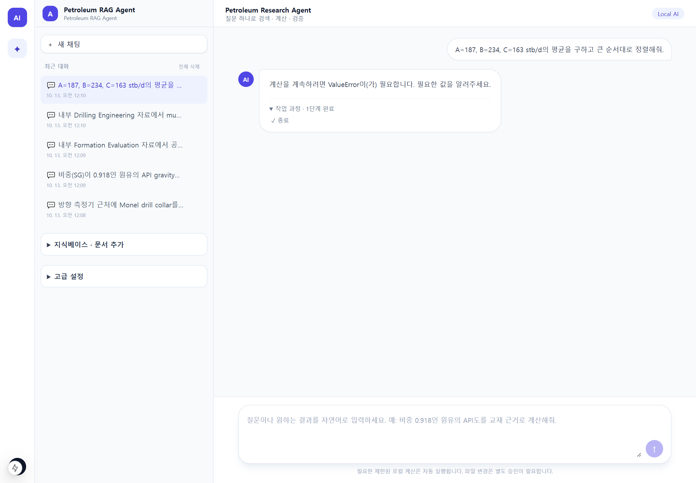

# V20 Browser E2E Validation

## Environment

- Validation branch: `validation/v20-browser-e2e`; evaluated product SHA: `9db8e190b143ac16720595c6b5393839e8b8d7db` (`feature/unified-autonomous-chat-v20`).
- Date: 2026-10-13 KST. Browser: Microsoft Edge Chromium 154.0.4258.53, headless, 1440 × 1000 CSS pixels at 1.5× device scale.
- Model: local Ollama `qwen3:8b`. Retrieval mode: `hybrid`, explicitly set for the controlled backend process. `check_retrieval_health.py` returned PASS.
- Existing production-style KB: `petroleum_knowledge`, **12 documents / 18,976 chunks**. No ingestion or reindexing was performed.
- Test services: frontend `http://127.0.0.1:3000`; controlled current-code backend `http://127.0.0.1:8001`. The pre-existing 8000 backend was left untouched. The stale 3000 frontend process was restarted after it returned HTTP 500 from missing Next.js build files.
- Browser inputs were typed into the actual main chat. Run IDs, action histories, evidence and calculations were read from the resulting API records; screenshots are unmodified browser captures. No product code changed during this validation.

Post-validation regressions: backend `.venv` `python -m pytest -q` **1,530 passed** (6 dependency deprecation warnings); frontend `pnpm test` **23 passed**; frontend `pnpm build` **passed**. These tests did not erase or override the browser failures below.

## Summary

| Scenario | Purpose | Actual actions | Iterations | Result | Verdict | Screenshot |
| --- | --- | --- | ---: | --- | --- | --- |
| A | Monel grounded QA | RETRIEVE → VERIFY → RETRIEVE → STOP | 3 | Insufficient Monel support; `no_progress` | **FAIL** | [A](screenshots/01_monel_final.png) |
| B | Sourced API gravity | RETRIEVE → CALCULATE → VERIFY → SYNTHESIZE → STOP | 4 | 22.64 °API, validated | **PASS** | [B](screenshots/02_api_gravity_final.png) |
| C | Natural SG follow-up | RETRIEVE → CALCULATE → VERIFY → SYNTHESIZE → STOP | 4 | SG corrected to 0.85; 34.97 °API | **PASS** | [C](screenshots/03_api_followup_final.png) |
| D | Chained Archie Rt | RETRIEVE → CALCULATE F | 2 | F validated; asked again for Rw unit, no Rt | **FAIL** | [D](screenshots/04_archie_final.png) |
| E | Missing TVD → same-run resume | RETRIEVE → RETRIEVE; resume stayed waiting | 2 | Asked for Pd instead of TVD; no calculation after TVD reply | **FAIL** | [waiting](screenshots/05_clarification_waiting.png), [resume](screenshots/06_clarification_resumed.png) |
| F (optional) | Direct mean/rank | CALCULATE → STOP | 1 | `calculation_blocked`; no validated result | **FAIL** | [F](screenshots/07_direct_calculation_final.png) |

**Mandatory scenarios A–E: 2/5 PASS.** Optional F also failed. A safe stop or a clarification does not count as successful task completion. All observed runs used fewer than the hidden eight-iteration ceiling; this alone does not establish adaptive success when the target remains unmet.

## UI integration

The browser showed one normal chat textarea, the unified “질문 하나로 검색 · 계산 · 검증” subtitle, and no visible Goal Research button, drawer, or maximum-iteration selector. Chat prompts launched autonomous runs. The compact “작업 과정” section rendered inside the assistant bubble and was expanded for the captures. This integration check **passed**. The legacy “고급 설정” disclosure remains collapsed in the sidebar; it is not a second Goal Research entrypoint.

## Scenario A — Monel

Prompt: “방향 측정기 근처에 Monel drill collar를 사용하는 이유를 내부 자료에 근거해 설명해줘.”

- Run `GR-20261012-150830-78EF44`: `stopped / no_progress`; actions RETRIEVE → VERIFY → RETRIEVE → STOP; 3 iterations; 1 internal source, 0 web sources, 0 computations.
- The retained source was *Heriot-Watt Drilling Engineering* p.475, a stabilizer passage, not direct support for the requested Monel explanation. The Agent declined to assert an unsupported claim. This is safer than hallucinating, but the grounded QA goal was not met.
- Likely failure class: retrieval/claim-support gap for this wording. A separate earlier development smoke used different Monel wording successfully; that does not change this browser result.

## Scenario B — API gravity

Prompt: “비중(SG)이 0.918인 원유의 API gravity를 내부 교재의 관계식을 이용해 계산하고, 사용한 식과 출처를 검증해줘.”

- Run `GR-20261012-150847-47F989`: `completed / achieved / goal_achieved`; 4 iterations; 5 internal sources, 0 web sources, 1 validated computation.
- Formula evidence `KB1`: *Heriot-Watt University - Reservoir Engineering.pdf*, **p.90**, literal relation `API = (141.5 / SG) - 131.5`. `CALC1` used explicit user fact SG=0.918 and returned raw 22.639433551…, displayed as **22.64 °API**.
- The normal answer showed the formula, citation chip, validated numeric claim, and expanded process. The screenshot contains the citation ID; the exact document/page association was confirmed in the run record, not captured as a tooltip image.

## Scenario C — Follow-up

Without starting a new chat, the user entered “그럼 0.85면?”

- New run `GR-20261012-150911-F82118` kept the previous **user** goal as bounded context (`conversation_context_used=true`, context message count 2) and bound SG=0.85 to the current literal follow-up. The previous assistant answer was not used as formula or numeric evidence.
- RETRIEVE → CALCULATE → VERIFY → SYNTHESIZE → STOP; 4 iterations; `completed / achieved`. Formula source was again *Reservoir Engineering* p.90 (`KB1`), with one validated `CALC1`. Raw result 34.970588235…, displayed as **34.97 °API**.

## Scenario D — Archie multi-step

Prompt supplied `φ=0.22`, `Sw=0.35`, `Rw=0.08 Ω·m`, `a=1`, `m=2`, `n=2`, and requested final target Rt using internal Formation Evaluation evidence.

- Run `GR-20261012-150940-A6223B`: RETRIEVE → CALCULATE F; 2 iterations; 5 internal sources; **one** validated calculation: `F=20.66115702479339` dimensionless.
- The final Rt calculation did **not** run. The state remained `waiting_for_user_input`, asking for “Rw 단위” even though the user had supplied `Ω·m`. Telemetry recorded `Rw` with an empty normalized unit and `required_target_outputs=[Rt]`.
- The target-completion guard behaved correctly in one respect: it did not declare success on intermediate F. The browser scenario fails because the supplied resistivity unit was not accepted and Rt≈13.493 Ω·m was absent. No `Fm` or `N=20.66` artifact appeared.

## Scenario E — Clarification / resume

Initial prompt requested hydrostatic pressure from MW=10.1 ppg using an internal Drilling Engineering relation, leaving TVD unspecified. The user then replied in the same chat: “TVD는 8000 ft야.”

- Run `GR-20261012-150957-4FBB2B` initially performed RETRIEVE → RETRIEVE and entered `waiting_for_user_input`; 6 internal sources, 0 validated calculations.
- Instead of TVD, the Agent asked for **Pd value and unit**. Telemetry identified the required target as **ECD**, not the requested hydrostatic pressure. This indicates a target/relationship routing or formula-selection error; the exact internal origin was not proven in this validation.
- The reply used the actual `/resume` endpoint with the **same run ID**, and `clarification_turns` rose to 1. However, the state and Pd question remained unchanged; no calculation or verified pressure was produced. Transport-level same-run resume worked, goal-level continuation did not.

## Optional scenario F — Direct calculation

Prompt: “A=187, B=234, C=163 stb/d의 평균을 구하고 큰 순서대로 정렬해줘.”

- Run `GR-20261012-151024-E2A338`: CALCULATE → STOP; 1 iteration; no retrieval, no Python call, no validated computation; `stopped / calculation_blocked`.
- The Agent selected the correct direct-calculation route and bound three operands, but returned a user-facing request for **“ValueError”** as though it were an input. Only the C operand had a normalized `stb/d` unit in telemetry; the precise exception source was not established. This is both an execution failure and an error-presentation bug.

## Failures / anomalies

1. **A — grounded QA recall/support:** the browser wording retrieved an unrelated p.475 stabilizer passage and stopped without a supported Monel explanation. The safe refusal avoided an unsupported assertion but did not satisfy the question.
2. **D — explicit engineering unit not bound:** `Ω·m` in the user input did not become Rw's normalized unit; a valid intermediate F was produced but Rt remained blocked.
3. **E — wrong requested target:** the hydrostatic-pressure request was routed to ECD/Pd, so the Agent asked for the wrong variable and same-run resume with TVD made no progress.
4. **F — direct calculation/error handling:** the calculation was blocked before Python, and `ValueError` leaked into the clarification text.
5. **Non-product harness issue:** the first automation attempt incorrectly treated the empty textarea's disabled Send button as a running state. Its raw result is preserved in [harness_initial_attempt.json](logs/harness_initial_attempt.json). Only the harness completion check was corrected; no product code changed. The completed validation above is the subsequent run. The development frontend emitted one initial hot-reload asset 404, then served the page normally; no scenario browser page exception was recorded.

Logs: [backend](logs/backend.log), [frontend](logs/frontend.log), [browser console](logs/browser_console.log). The backend log also contains non-fatal Chroma telemetry capture warnings; API requests themselves returned 2xx.

## Poster recommendations

Only **two task scenarios** passed. Therefore no successful grounded-QA or Archie-chain image is recommended. The three copied candidates are deliberately limited to what the browser verified:

1. [Unified chat home](poster_candidates/poster_01_unified_chat_home.png) — product layout, not a task-success claim.
2. [Sourced API gravity](poster_candidates/poster_02_api_gravity.png) — literal KB formula, citation and validated numeric output.
3. [Natural follow-up](poster_candidates/poster_03_followup.png) — conversation continuity with a newly validated value.

Do **not** present A, D, E or F as successful examples. The candidate screenshots include substantial blank viewport area; crop/layout refinement for a poster should preserve the original content and not imply unobserved behavior.

## Final conclusion

Real Edge-driven chat input verified the single-chat UI, sourced API gravity calculation and natural follow-up correction. It also exposed four distinct product failures in the requested or optional scenarios. V20 should **not** be described as browser-E2E validated for general grounded QA, chained resistivity calculation, clarification success, or direct arithmetic on the basis of this run. This is a validation record, not a final benchmark or a product fix.
